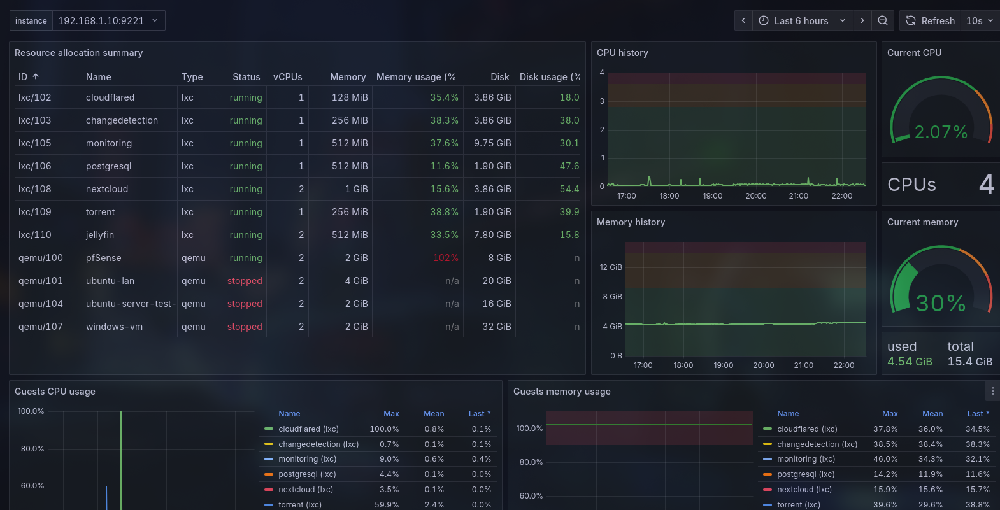

# 🏠 Complete Home Lab Setup Guide

This comprehensive guide will walk you through building a complete home lab infrastructure using Proxmox as the virtualization platform, pfSense for network security and routing, and Cloudflare tunnels for secure remote access.

## 📋 Table of Contents
- [Prerequisites and Planning](./prerequisites-and-planning.md)
- [Environment Preparation](./environment-preparation.md)
- [Proxmox Installation and Initial Setup](./proxmox-installation.md)
- [Proxmox Backup Guide](./proxmox-backup-guide.md)
- [PVE Bind-Mount Guide](./bind-mount.md)
- [Basic Security and SSH Configuration](./basic-security-and-ssh.md)
- [Network Architecture and pfSense Setup](./network-and-pfsense.md)
- [OPNsense PPPoE & VLAN Setup](./virtual-pppoe-router.md)
- [Remote Access with Cloudflare Tunnels](./remote-access-cloudflare.md)
- [Zero Trust Security Implementation](./zero-trust-security.md)
- [Securing Services with mTLS](./mTLS-cert.md)
- [Maintenance and Logging](./maintenance-and-logging.md)
- [Monitoring Your Home Lab](./monitoring.md)

**Advanced Networking (optional deep-dives):**
- [Bare-Metal Router Performance with PCI Passthrough](./pci-passthrough-router.md)
- [Replacing Your ISP's ONT with a Rooted GPON SFP Module](./gpon-sfp-ont-replacement.md)
- [Wi-Fi Access Point via PCI Passthrough + OpenWrt VM](./wifi-ap-pci-passthrough.md)
- [Segmenting LAN and Service Networks with OPNsense](./network-segmentation-opnsense.md)
- [Local HTTPS Access to Self-Hosted Services (Split-DNS + Virtual IPs)](./local-https-split-dns.md)
- [Local Reverse Proxy with Caddy](./caddy.md)

## 🛠️ Services

Here are the services I am running in my home lab. Each service has its own installation guide.

- [ChangeDetection.io](./services/changedetection-io.md)
- [Nextcloud](./services/nextcloud.md)
- ~~[Transmission](./services/transmission.md)~~
- [qBittorrent](./services/qbittorrent.md)
- [Jellyfin](./services/jellyfin.md)
- [Stirling PDF](./services/stirlingpdf.md)

